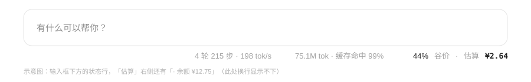

# dsh-usage-bar

> Three numbers on the line you are already looking at, right next to the context meter: current price window, this session's estimated cost, and the account balance.

English | [中文](README.md)

<table align="center" border="0" cellspacing="0" cellpadding="0">
  <tr>
    <td align="center" valign="top">
      <br>
      <b>Official account (Chinese)</b>
    </td>
    <td width="40"></td>
    <td align="center" valign="top">
      <br>
      <b>WeChat: 周杰 律师</b>
    </td>
  </tr>
</table>

## What it solves

Harness already shows per-reply token details and the account balance, but nothing tells you "how much has this session cost so far". This plugin turns the empty strip below the three columns into a one-line, always-on status bar that accumulates with the session.



## What it shows

| Field | Meaning |
| --- | --- |
| Peak / Off-peak | The current official pricing window (Beijing time, weekdays 09:00-12:00 and 14:00-18:00 are peak) |
| Estimate | This session's tokens priced at the current window, in CNY |
| Balance | Account balance = topped-up + granted wallets, refreshed once a minute |

Hover the estimate for the four token buckets, the model's unit prices, and a reminder that it is an estimate, not a bill. Hover the balance for the topped-up / granted split. When signed out or unreachable, the balance shows `—`.

The numbers come from the `tokenUsage` session projection and accumulate over the whole durable session log, so a page refresh does not reset them.

## Install

### Option 1 — from a plugin market

Enable **Experimental plugins → Custom plugin market**, then add this index under **Discover → Add index source**:

```text
https://jayden645253207-hub.github.io/dsh-usage-bar/index.json
```

Search for `dsh-usage-bar`, install, restart DSH.

### Option 2 — command line

```sh
dsh plugin --profile desktop add git+https://github.com/jayden645253207-hub/dsh-usage-bar.git
```

Restart DSH. The package also declares `dsh.bundle`, so installing it registers it as a profile layer; no manual `cordis.patch.yml` edit is needed.

### Option 3 — local development

```sh
git clone https://github.com/jayden645253207-hub/dsh-usage-bar.git
cd dsh-usage-bar
./install.sh          # symlinks into ~/.dsh/profiles/desktop and appends one insert
```

`./uninstall.sh` reverts it. Editing `lib/client.js` takes effect after a page reload.

## Pricing

cost = (uncached input × miss price + cache reads × hit price + output × output price) ÷ 1,000,000 × window factor

Prices follow the [official DeepSeek pricing page](https://api-docs.deepseek.com/quick_start/pricing), fetched 2026-10-26. Unit: **CNY per 1M tokens, peak-hour price**.

| Model | Cache hit | Cache miss | Output |
| --- | --- | --- | --- |
| `deepseek-flash` | 0.04 | 2 | 8 |
| `deepseek-v4-pro` | 0.30 | 9.0 | 27.0 |

- Off-peak is half of peak (window factor 0.5).
- Peak hours: Monday to Friday, 09:00–12:00 and 14:00–18:00 Beijing time.
- Cache writes are not billed separately (they are part of the uncached input), so they only appear in the tooltip.

Edit the `PRICES` and `PEAK_WINDOWS_CST` constants at the top of `lib/client.js` when prices change.

### Known deviations

1. **Chinese public holidays are not modelled.** Officially a holiday is off-peak all day; this plugin would still charge peak prices during work hours on a holiday, so it over-estimates then.
2. A session spanning both windows is priced at the **current** window's rate over the accumulated tokens, not request by request.
3. It is **not a bill**. The authoritative numbers are under Settings → Account & balance → View usage.

## How it works

A DSH plugin is a dual-face package:

- `lib/index.js` (host) is empty; it only has to exist so the package can sit in the Cordis tree, which the host scans to compose the browser boot manifest.
- `package.json` `dsh.client` exposes the `./client` entry, served by the host under `/plugins`.
- `lib/client.js` is a `window.__ModuleLoader__.load({ id, factory })` bundle that only requires `react` (a platform seed module) and has no third-party dependencies.
- The three fields register into `conversation.composer.dock` (the row under the composer) and use CSS `order: 99` to sit after the context-percentage ring.
- Token numbers come from `useProjection("tokenUsage")` and `useProjection("modelSelection")`; the balance calls `ctx.remote.account.getBalance()`, the same remote method the settings page uses.
- The cost is recomputed once a minute so the peak/off-peak label follows the clock.

## Verified scope

- Pricing, window boundaries (including the half-open ends at 12:00 and 18:00, and weekends), number formatting and balance folding have unit tests, all passing.
- Development environment: macOS desktop app, DSH `0.2.1-rc.3`.

Not verified: Windows, other DSH versions, concurrent main sessions. The slot and projection APIs are internal contracts and may change between DSH versions; if the bar disappears, check the browser console for `shell.bottom` or `client-modules` errors.

## Feedback

- Bugs and reproductions: [GitHub Issues](https://github.com/jayden645253207-hub/dsh-usage-bar/issues)
- Updates: the WeChat official account above
- Other contact: WeChat above

## License

[MIT](LICENSE) © 2026 Zhou Jie
